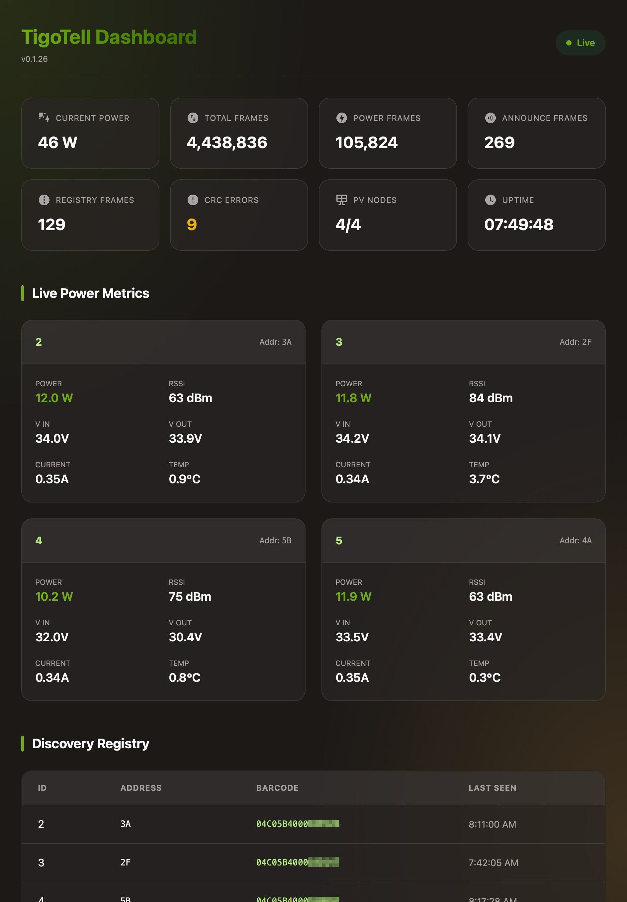

# TigoTell

**Tigo CCA/TAP sniffer built atop Waveshare ESP32-S3-RS485-CAN.**

Non-intrusively monitors communication between Tigo Cloud Connect Advanced (CCA) and Tigo Access Point (TAP) or solar modules to extract real-time telemetry data.

## 📸 Overview



**TigoTell** passively listens to the RS485 communication lines of your Tigo solar installation. By sniffing the packets exchanged between the CCA and the TAP, it decodes module-level power statistics, discovering nodes automatically without interfering with the proprietary network. This allows you to log fine-grained solar data into databases like InfluxDB while the official hardware remains unaware.

## ✨ Features

- **Passive Sniffing**  
  Safe, receive-only RS485 monitoring without disrupting existing communications.
- **Data Parsing**  
  Decodes Tigo essential frames (Voltage, Current, Temperature, Duty Cycle, RSSI, etc.).
- ️**Runtime Configuration**  
  Configure hardware pins, InfluxDB details, and reporting intervals via Web UI.
- **InfluxDB Integration**  
  Streams parsed telemetry directly to an InfluxDB instance over UDP line-protocol.
- **MQTT Publishing**  
  Periodically publishes per-module data points and system stats as JSON to an MQTT broker.
- **Home Assistant Discovery**  
  TigoTell, every module and every TAP appear in Home Assistant as devices with sensors via MQTT discovery.
- **TAP Status**  
  Tracks each Tigo Access Point on the bus: polls answered, buffer levels, modules heard and their signal, plus barcode, firmware and radio channel when the CCA queries them.
- **System Layout**  
  Draw a plan of your installation (panels, rectangles, lines, text), link each panel to its Tigo module and watch live output per panel.
- **Device Health & Self-Healing**  
  Restart reason, crash reports, memory and WiFi diagnostics; loop watchdog, WiFi reconnect and restart on persistent memory exhaustion.
- ️**REST APIs**  
  Live JSON endpoints for power data, system discovery statistics, and parser health.
- **WebSerial Debugging**  
  Built-in web-based serial console.
- **OTA Updates**  
  Fast and secure Over-The-Air firmware updates using ElegantOTA.
- **WiFi Management**  
  AP-based initial setup for seamless network provisioning utilizing NetWizard.

## 📋 Requirements

### Hardware

- **Base Board**  
  Waveshare ESP32-S3-RS485-CAN (or a comparable ESP32-S3 board with an RS485 transceiver).
- **Communications Wiring**  
  Connection to the RS485 A and B lines between the Tigo CCA and TAP.
- **Power**  
  Can usually be run off the same power supply as the Tigo CCA. With a 12 V / 1 A supply the budget gets tight while the CCA is busy (e.g. during module discovery); Tigo recommends 24 V. Do not power the board from the screw terminal and USB at the same time.

### Software / Dependencies

- [pioarduino](https://github.com/pioarduino/platform-espressif32) Core (CLI) or VSCode IDE extension.
- _(Optional)_ An **InfluxDB** and/or **Telegraf** instance (configured to receive UDP datagrams) if you wish to record time-series metrics.

## 🚀 Getting Started

### Installation

#### Option 1: One-Click Install (Easiest)

If you have a Chrome-based browser (Chrome, Edge, Opera), you can flash TigoTell directly from your browser. This will install the firmware and filesystem in one go.

1.  Connect your Waveshare board to your computer via USB.
2.  Use a web flasher, such as the one hosted by ESPHome:

    [**⚡ Install TigoTell (Web Flasher)**](https://web.esphome.io/?manifest=https://github.com/gongloo/TigoTell/releases/latest/download/manifest.json)

3.  Select your device's COM port and follow the prompts.

---

#### Option 2: Manual Flash (via Browser)

If you prefer to flash files individually:

1.  Download `tigotell-factory.bin` from the **[Latest Release](https://github.com/gongloo/TigoTell/releases/latest)**.
2.  Go to **[web.esphome.io](https://web.esphome.io/)** or **[Adafruit WebSerial ESPTool](https://adafruit.github.io/Adafruit_WebSerial_ESPTool/)**.
3.  Flash **`tigotell-factory.bin`** to offset **`0x0`**. (This single file contains the bootloader, partitions, firmware, and filesystem).

_(If you chose to download `firmware.bin` and `littlefs.bin` separately, use offsets `0x10000` and `0xc90000` respectively.)_

---

#### Option 3: Build and Flash (CLI)

If you prefer to build from source using **pioarduino** or **PlatformIO**:

No manual configuration of source files is required for the initial build. Hardware settings (GPIO pins), InfluxDB details, and reporting intervals are handled dynamically via the **Web Dashboard** after deployment.

Use **pioarduino** or **PlatformIO** to compile and flash the firmware via USB:

1. **Clone the repository**:

   ```bash
   git clone https://github.com/gongloo/TigoTell.git
   cd TigoTell
   ```

2. **Flash via USB**:

   ```bash
   # Build and upload the firmware
   pio run -e esp32-s3-devkitm-1 -t upload

   # Build and upload the filesystem (LittleFS)
   pio run -e esp32-s3-devkitm-1 -t uploadfs
   ```

#### Optional: OTA Configuration

If you wish to upload updates over your local network using PlatformIO:

1. Provision your device with WiFi credentials and **set your OTA username/password via the Web UI**.
2. **Create the upload configuration**:
   ```bash
   cp platformio_upload.example.ini platformio_upload.ini
   ```
3. **Edit `platformio_upload.ini`**: Update `custom_upload_url` with your device's IP or mDNS address (e.g., `http://tigotell.local/update`), and set the `custom_username` and `custom_password` to match what you have configured in the Web UI.

### Network Provisioning

1. Once flashed, the ESP32 will broadcast a WiFi Access Point named `TigoTell`.
2. Connect to this network on your phone or computer.
3. A captive portal should appear (or navigate to `192.168.4.1`).
4. Enter your local WiFi credentials to connect the device to your network.

### Usage

Once connected to your local network, you can access the device in your browser via mdns (`http://TigoTell.local`) or its assigned IP address.

- **Settings**: Click the **Cog Icon** on the dashboard to configure Hardware Pins (TX, RX, EN), InfluxDB host/port, MQTT broker, and reporting intervals.
- **`/layout.html`**: Graphical system layout (also via the grid icon on the dashboard). See below.
- **`/json`**: Returns a snapshot of all discovered nodes and their latest parsed data, including system stats.
- **`/version`**: Returns the current firmware version and build timestamp.
- **`/update`**: Access the ElegantOTA firmware update portal. It is enabled once OTA username and password are set in the settings and the device has been rebooted; until then the page explains this.
- **`/webserial`**: View live serial log output.

### Barcodes

Barcodes are shown in Tigo's label format (e.g. `4-EF82C4J`, as printed on the optimizer and shown in the Tigo app) on the power cards, in the registry, the layout editor, MQTT and Home Assistant; `/json` additionally lists the raw 64-bit `long_address`. The CCA's node table marks module IDs with bit 0x8000 while power reports use the plain ID; TigoTell strips the bit so both match. The module-ID-to-barcode map is kept in NVS, because the CCA only sends its node table occasionally (mostly while modules are being added).

### Device health

The dashboard's **Device Health** section shows why TigoTell last restarted (power on, crash, watchdog, brownout, or a deliberate self-healing restart), how long the previous run lasted and its lowest free memory, current memory, WiFi signal and drops, and the most recent crash report. After an unexpected restart a notice appears at the top of the dashboard. `/json` includes the same data under `system` (plus free NVS entries).

Self-healing: a watchdog restarts TigoTell if the main loop stalls for 5 s; after 1 minute without WiFi it reconnects, after 10 minutes it restarts (not while someone uses the setup portal); it also restarts if the largest free memory block stays below 10 KB for a minute.

Crash reports contain a backtrace of addresses. `tools/decode-crash.py firmware.elf "<crash text>"` (needs `pip install pyelftools`) turns them into function names; use the `firmware.elf` of the exact version that crashed.

### TAP status

The dashboard's **Gateways (TAP)** section lists every TAP the CCA talks to, keyed by its gateway ID. Everything is observed passively:

- **Polls answered**: share of the last 64 receive polls the TAP answered (state *Missing polls* below 90 %, *Offline* after 60 s without a frame). Frames lost to CRC errors on the sniffer also count as missed.
- **Rx buffers used / Tx buffers free**: the TAP's own buffer status from its responses; a persistently full receive buffer or no free transmit buffers indicate a backlog.
- **Modules / Avg. module signal**: modules whose reports arrived through this TAP in the last 5 minutes, and their raw RSSI values.
- **Barcode, firmware, radio channel/PAN**: only exchanged when the CCA enumerates the TAPs (typically when the CCA starts), so they appear after the CCA restarts.

`/json` contains the same data under `taps`, and each power entry names the TAP it came through (`gateway`). Over MQTT each TAP is published to `tigotell/tap/<id>`, and Home Assistant discovery adds a device per TAP (connection, polls answered, modules, buffers, missed polls). Protocol details follow [taptap's documentation](https://github.com/willglynn/taptap/blob/main/docs/protocol.md).

### System Layout

Open `/layout.html` (or the grid icon on the dashboard) and click **Edit**. Tools: panel, row of panels, rectangle, line and text. Drag empty space to pan, scroll or pinch to zoom, Shift-drag to select several elements; Delete, Ctrl+Z/Ctrl+Shift+Z, Ctrl+D and the arrow keys work as expected.

To link panels and modules, open the **Modules** tab, pick a module (its barcode matches the optimizer label) and tap its panel, or drag the module onto the panel. Texts and rectangle labels can show live values via placeholders such as `{total_power}`, `{node:12.temperature}` or, in rectangle labels, `{group.power}` (sum of the panels inside). **Strings**: in the editor's Strings tab, create strings and pick their panels (tap, or swipe across several), or select panels and set the string under Properties. Panels show their string as a colored frame; the view lists each string with power, voltage (sum of module output voltages) and reporting panels, and tapping a string highlights it. Placeholders: `{string:1.power}`, `{string:1.voltage}`, `{string:1.active}`, `{string:1.count}`. The view colors panels by power, voltage, current, temperature or RSSI, or by string. Text elements can be rotated. **Simulate** in the editor fills all panels (linked or not) with made-up data and a sunlight slider to preview the live look; simulated data is never saved.

The layout is stored in the device's settings storage (NVS), so filesystem updates keep it. NVS is shared with WiFi and settings, so the layout gets up to 8 KB of what is free while a reserve is kept for the rest; the editor shows the room available. Each save is read back to confirm it, and WebSerial logs size, duration and remaining space. Use **Export** to keep a backup, e.g. before a factory flash.

### MQTT

Set the broker host (and optionally port, username/password, base topic and publish interval) in the **MQTT Publishing** section of the settings page. Changes take effect immediately; leave the broker empty to disable MQTT. A green/red **MQTT** pill on the dashboard shows the connection state.

Every publish interval, TigoTell sends (base topic defaults to `tigotell`):

| Topic | Payload |
| --- | --- |
| `tigotell/node/<pv_node_id>` | `{"pv_node_id","address","barcode","power","voltage_in","voltage_out","current_in","temperature","duty_cycle","rssi","age_s"}` for each module heard from within the last 60 s |
| `tigotell/stats` | `{"total_power","active_nodes","known_nodes","total_frames","crc_errors","power_count","announce_count","nodetable_count","uptime_s","version"}` |
| `tigotell/status` | `online` / `offline` (retained, Last Will) |

Units: W, V, A, °C, dBm. Values are the latest reading per module (as on the dashboard), not interval averages.

#### Home Assistant

With **Home Assistant Discovery** enabled (default), TigoTell announces itself and every module as Home Assistant devices with sensors (power, voltages, current, temperature, plus diagnostic duty cycle/RSSI; total power, active modules, CRC errors and uptime for TigoTell itself). Configs are sent retained to `homeassistant/device/<id>/config` using device-based discovery (Home Assistant 2024.11+), and re-sent whenever Home Assistant restarts. Module sensors become unavailable when a module stops reporting (e.g. at night). For the Energy dashboard, add an *Integral* helper on a power sensor.

Alternatively, [miketkf/ha-tigotell](https://github.com/miketkf/ha-tigotell) provides a separate Home Assistant integration for TigoTell.

## 🙏 Credits & Acknowledgments

This project stands on the shoulders of the incredible reverse-engineering work done by the community. A massive thank you to the following projects which provided the foundation for decoding the Tigo protocols:

- **[willglynn/taptap](https://github.com/willglynn/taptap)**: Excellent documentation and implementation of the Tigo wireless protocol. TigoTell's TAP status, barcode format and node-table handling follow its protocol documentation.
- **[tictactom/tigo_server](https://github.com/tictactom/tigo_server)**: Fundamental research and parsing logic for the Tigo CCA/TAP communications.
- **Google Gemini**: For AI pair-programming assistance in building and structuring this project!
- **Anthropic Claude**: AI pair-programming assistance for later extensions and fixes.
- **[Google Material Design Icons](https://fonts.google.com/icons)**: Used for the web dashboard visualization (licensed under the Apache License 2.0).

## 📄 License

MIT, see [LICENSE](LICENSE); the original copyright notice is retained. The firmware links third-party libraries under their own licenses, including AGPL-3.0 and LGPL-3.0 libraries; see [THIRD_PARTY_NOTICES.md](THIRD_PARTY_NOTICES.md).
